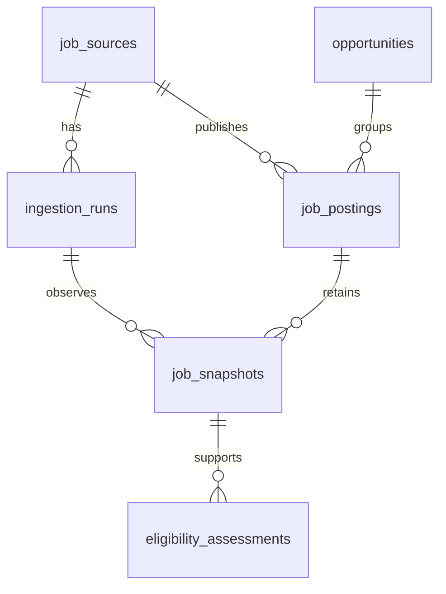

# Architecture

For an explanatory walkthrough following the Hello Interview framework, see [SYSTEM_DESIGN.md](SYSTEM_DESIGN.md). This page is the concise architecture reference.

Phase 1: a TypeScript modular monolith with two entry points and PostgreSQL. The API reads persisted data; the ingestion CLI shares normalization and database modules. No scheduler, queue, Redis, LLM, or UI service is required.

```text
Configured Lever site / fictional fixture
  -> bounded fetch / fixture reader
  -> payload validation -> normalization
  -> transaction per posting
       opportunity + posting + changed snapshot + geography assessment
  -> ingestion run outcome

PostgreSQL -> NestJS read-only paginated API -> developer / future client
```



`packages/contracts` defines boundary schemas and types. `packages/core` owns adapters, normalization, classification and ingestion coordination. `packages/database` owns SQL and migrations. `apps/ingest` and `apps/api` are composition roots.

Source identity is provider + region + site + mode (FIXTURE/LIVE). Posting identity is source ID + external ID. URLs are provenance, never the sole uniqueness key. Each new posting gets an opportunity without speculative cross-posting merges. Older changed observations are rejected; unchanged observations never regress freshness.

Unknown source dates and attributes stay null/unknown. Observation freshness is distinct from posting age. Snapshots retain raw and normalized content plus mapping version; the posting's latest provenance tracks the last successful sighting even on partial runs. Missing posts are never automatically closed in Phase 1. Posting history is append-only through the repository; this is not a claim that database administrators cannot edit their local database.

Each source has a session advisory lock, released on completion or connection loss. Each posting transaction also locks its exact source/ID, preventing concurrent duplicate inserts and orphan opportunities. Malformed records are rejected individually. Unknown persistence failures stop the crawl; expected older-content rejections can continue. Run outcomes distinguish complete enumeration from error-free processing: a complete crawl containing malformed records can still be PARTIAL. Error samples are capped at 50; counters retain total accepted/rejected records. An interrupted process can leave RUNNING until the next locked run marks it ABORTED; unfinalized counters may underreport committed records.

Live requests are GET-only against fixed Lever API hosts. Source identifiers are validated. Redirects, excessive payloads, timeouts and retry exhaustion are errors; no fetched instructions execute. HTML is converted to text before display/classification. Raw source content is retained as evidence, not executable markup.

Implementation status and verification: see ROADMAP.md and VERIFICATION.md.

## HTTP boundary

The API binds to loopback only. GET /health checks process liveness; GET /ready checks the database and expected migration fields. GET /jobs validates a strict filter schema, uses parameterized SQL and bounded offset pagination, and omits descriptions/raw payloads. GET /jobs/:id returns description, current raw provenance, latest observation, and metadata for the last 20 preserved versions. A repeatable-read transaction keeps each list/count or detail response internally consistent. Different pagination requests can shift if ingestion changes the dataset between requests.

Errors have `{error:{code,message,requestId,details?}}`; internal database details are not returned. Request IDs are server-generated. Responses use JSON, no-store, nosniff, and a restrictive CSP. No HTML renderer, CORS access, arbitrary fetch endpoint, or write API exists in Phase 1. Local loopback is the security boundary; shared hosting requires authentication and an explicit later review.
