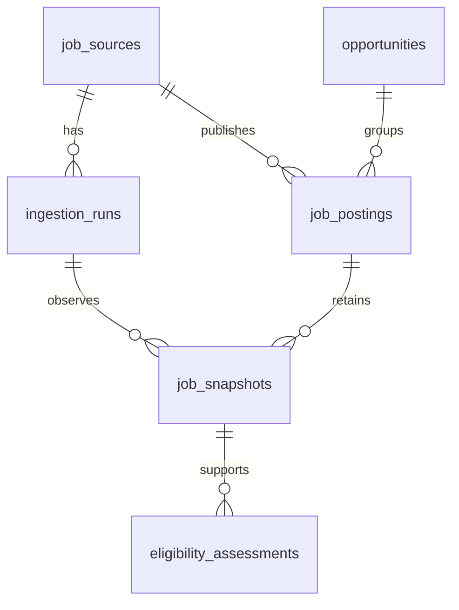

# Architecture

Phase 1: a TypeScript modular monolith with two entry points and PostgreSQL. The API reads persisted data; the ingestion CLI shares normalization and database modules. No scheduler, queue, Redis, LLM, or UI service is required.

```text
Configured Lever site / fictional fixture
  -> bounded fetch / fixture reader
  -> payload validation -> normalization
  -> transaction per posting
       opportunity + posting + changed snapshot + geography assessment
  -> ingestion run outcome

PostgreSQL -> NestJS read-only paginated API -> developer / future client
```



`packages/contracts` defines boundary schemas and types. `packages/core` owns adapters, normalization, classification and ingestion coordination. `packages/database` owns SQL and migrations. `apps/ingest` and `apps/api` are composition roots.

Source identity is provider + region + site + mode (FIXTURE/LIVE). Posting identity is source ID + external ID. URLs are provenance, never the sole uniqueness key. Each new posting gets an opportunity without speculative cross-posting merges. Older changed observations are rejected; unchanged observations never regress freshness.

Unknown source dates and attributes stay null/unknown. Observation freshness is distinct from posting age. Snapshots retain raw and normalized content plus mapping version; observations track the latest successful sighting even on partial runs. Missing posts are never automatically closed in Phase 1.

Live requests are GET-only against fixed Lever API hosts. Source identifiers are validated. Redirects, excessive payloads, timeouts and retry exhaustion are errors; no fetched instructions execute. HTML is converted to text before display/classification. Raw source content is retained as evidence, not executable markup.

Implementation status and verification: see ROADMAP.md and VERIFICATION.md.
