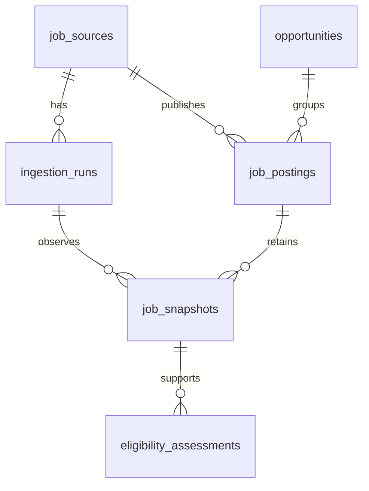

# Architecture

For an explanatory walkthrough following the Hello Interview framework, see [SYSTEM_DESIGN.md](SYSTEM_DESIGN.md). This page is the concise architecture reference.

Phases 1–2: a TypeScript modular monolith with API and ingestion entry points, PostgreSQL, and a separate Next.js UI process. The API reads persisted data; the ingestion CLI shares normalization and database modules. Next.js reads the API on the server. No scheduler, queue, Redis or LLM is required.

```text
Configured Lever site / Greenhouse board / fictional fixture
  -> bounded fetch / fixture reader
  -> payload validation -> normalization
  -> transaction per posting
       opportunity + posting + changed snapshot + geography assessment
  -> ingestion run outcome

PostgreSQL -> NestJS read-only paginated API -> Next.js server -> browser
```



`packages/contracts` defines boundary schemas and types. `packages/core` owns adapters, normalization, classification and ingestion coordination. `packages/database` owns SQL and migrations. `apps/ingest` and `apps/api` are composition roots.

`apps/web` is the UI boundary. Its server pages validate API responses using shared runtime schemas, with uncached reads and a five-second timeout. The browser requests only frontend pages; the UI has no database dependency. URL parameters preserve filters, pagination and selected posting. Client components handle forms, refresh and inspector tabs. Source descriptions and raw JSON render as text. FIXTURE records and the provider's demo feed carry explicit labels. GET /sources supplies whole-source counts and latest run status, independent of list filters.

Source identity is provider + region + site + mode (FIXTURE/LIVE). Posting identity is source ID + external ID. URLs are provenance, never the sole uniqueness key. Each new posting gets an opportunity without speculative cross-posting merges. Older changed observations are rejected; unchanged observations never regress freshness.

Unknown source dates and attributes stay null/unknown. Observation freshness is distinct from posting age. Snapshots retain raw and normalized content plus mapping version; the posting's latest provenance tracks the last successful sighting even on partial runs. Missing posts are never automatically closed in Phase 1. Posting history is append-only through the repository; this is not a claim that database administrators cannot edit their local database.

Each source has a session advisory lock, released on completion or connection loss. Each posting transaction also locks its exact source/ID, preventing concurrent duplicate inserts and orphan opportunities. Malformed records are rejected individually. Unknown persistence failures stop the crawl; expected older-content rejections can continue. Run outcomes distinguish complete enumeration from error-free processing: a complete crawl containing malformed records can still be PARTIAL. Error samples are capped at 50; counters retain total accepted/rejected records. An interrupted process can leave RUNNING until the next locked run marks it ABORTED; unfinalized counters may underreport committed records.

Live requests are GET-only against fixed Lever API hosts or Greenhouse's documented `boards-api.greenhouse.io` endpoint. Both adapters share bounded JSON transport and plain-text conversion. Source identifiers are validated. Redirects, excessive payloads, timeouts and retry exhaustion are errors; no fetched instructions execute. HTML is converted to text before display/classification. Raw source content is retained as evidence, not executable markup.

Phase 3A extends the provider constraint through a third migration, with no new domain tables. Greenhouse region is `global` for the verified endpoint regardless of job country. Its posting ID (not internal job ID) supplies identity. `content=true` returns a full-board envelope: compare record count with `meta.total` and detect duplicate IDs; mismatches preserve accepted records but report incomplete enumeration without refetching the same envelope as another page. Source-supplied first-published and updated timestamps remain separate. Nonstandard workplace/country/employment attributes stay unknown; they are not inferred from a remote title. The existing exact-source view supports employer pilots; combined demo-free search, profile matching and daily scheduling remain subsequent work.

Implementation status and verification: see ROADMAP.md and VERIFICATION.md.

## HTTP boundary

The API binds to loopback only. GET /health checks process liveness; GET /ready checks the database and expected migration fields. GET /sources returns source health, latest run/completeness and counts, including sources not yet run. GET /jobs validates a strict filter schema, uses parameterized SQL and bounded offset pagination, and omits descriptions/raw payloads. GET /jobs/:id returns description, current raw provenance, latest observation, and metadata for the last 20 preserved versions. A repeatable-read transaction keeps each list/count or detail response internally consistent. Different pagination requests can shift if ingestion changes the dataset between requests. Separate jobs, sources and detail requests can also observe different commits; dashboard-wide atomicity is not claimed.

Errors have `{error:{code,message,requestId,details?}}`; internal database details are not returned. Request IDs are server-generated. API responses use JSON, no-store, nosniff, and a restrictive CSP. There is no API HTML renderer, CORS access, arbitrary fetch endpoint, or write API. The frontend and API bind to loopback, while Compose runs only PostgreSQL. Local loopback is the security boundary; shared hosting requires authentication and an explicit later review.
