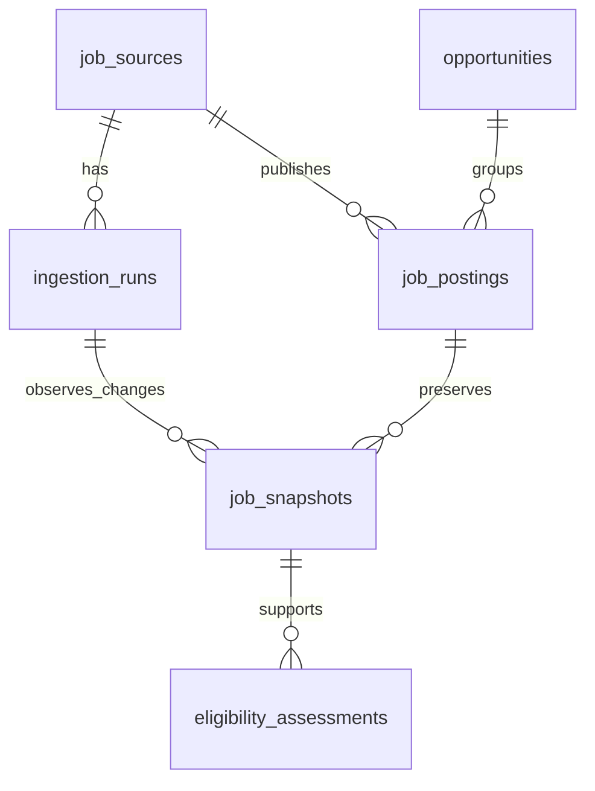
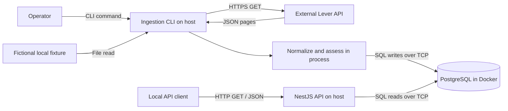

# Career Radar: system design walkthrough

This explains the implemented Phase 1 system using the sequence in [Hello Interview's System Design Delivery Framework](https://www.hellointerview.com/learn/system-design/in-a-hurry/delivery): requirements, core entities, system interfaces, data flow, high-level design, and deep dives. The framework supplies the explanation structure; the design and tradeoffs below describe Career Radar's code.

Status: Phase 1 complete, 2026-10-21. Seven implementation/documentation commits established the working foundation. Build, strict type checks, lint, 51 unit tests, and 42 PostgreSQL integration tests passed, including a fresh-source setup. A bounded live read stored ten Lever demo postings. See [verification evidence](VERIFICATION.md) for exact commands and limitations.

## 1. Requirements

### Functional requirements

The initial system must let its operator:

1. Collect published jobs from a configured employer's Lever account, or replay fictional offline fixtures through the same normalization path.
2. Store consistent job records without duplicate postings, retain changes, and explain where each record came from.
3. Query/filter those records and inspect a conservative India-remote geography signal with supporting evidence.

The broader product will evaluate candidate fit and career value. Profiles, ranking, applications, resumes, and a dashboard belong to later reviewed phases.

### Non-functional requirements

| Requirement | Design consequence |
| --- | --- |
| Correctness under retries | Database uniqueness, source/posting locks, and idempotent persistence. |
| Explainable decisions | Raw source snapshots, normalized content, exact evidence passages, observation dates, and mapping/classifier versions. |
| Failure isolation | Commit each posting independently; report incomplete runs; never close missing postings automatically. |
| Practical local operation | Host Node.js processes; PostgreSQL is the only Docker Compose service. |
| Bounded external access | Fixed provider hosts, GET-only requests, timeouts, byte/page limits, pacing, and limited retries. |

This is currently a single-user local system. No production traffic target or latency/capacity benchmark has been established. The implemented crawl ceiling is 100 pages with at most 100 records per page; that is an operating bound, not a throughput guarantee.

## 2. Core entities

| Entity/table | Meaning | Important state |
| --- | --- | --- |
| `job_sources` | One configured employer/provider source in a particular environment. | Provider, region, site, FIXTURE/LIVE mode, employer configuration, policy metadata, health. |
| `ingestion_runs` | One attempt to collect that source. | Start/finish, status, completeness, accepted/rejected/change counters, bounded error samples. |
| `opportunities` | A lasting identity for a vacancy that can eventually group several postings. | Canonical ID. Phase 1 creates one opportunity per new posting. |
| `job_postings` | The current normalized representation of one provider posting. | Source/external ID, opportunity ID, title/location/workplace, first/last observation, current snapshot, latest run/provenance. |
| `job_snapshots` | A preserved content version of a posting. | Revision, raw and normalized content, content hash, mapping version, fetch provenance, observation time. |
| `eligibility_assessments` | A versioned geography assessment supported by one snapshot. | Context, result, reason codes, source passages/offsets, classifier version, checked date. |



The distinction between **opportunity** and **posting** prevents a future repost or second website from forcing us to lose the vacancy's history. Phase 1 establishes that relationship without guessing which different listings refer to the same opening. Cross-source merging requires a later reviewed workflow.

Source uniqueness is `(provider, region, site, mode)`; posting uniqueness is `(source_id, external_id)`. Separating FIXTURE and LIVE mode prevents a demo replay from overwriting live records, even if site identifiers match.

The schema is implemented in [the initial migration](../packages/database/migrations/1792569600000_initial.sql) and [the latest-observation migration](../packages/database/migrations/1792569601000_latest_observation.sql).

## 3. APIs and system interfaces

### User-facing HTTP API

| Endpoint | Responsibility |
| --- | --- |
| `GET /health` | Report that the API process is alive. |
| `GET /ready` | Verify database access and required migration fields; return 503 if unavailable. |
| `GET /jobs` | Return filtered, paginated summaries. |
| `GET /jobs/:id` | Return description, source/run context, geography evidence, raw current provenance, and recent history metadata. |

Example:

```http
GET /jobs?title=Backend&location=India&workplace=REMOTE&mode=FIXTURE&page=1&limit=20
```

Other filters are `source` (UUID) and `observedSince` (timestamp with timezone). Filters combine with AND. Title/location matching is a literal case-insensitive substring; `%` and `_` in user input do not become SQL wildcards. Page size is capped at 100.

Lists return `{data, pagination}`. Detail returns `{data}`. Errors return `{error:{code,message,requestId,details?}}`. A server-generated request ID also appears in `X-Request-Id`. Unknown or malformed parameters produce 400, and a valid but absent job ID produces 404.

### Ingestion interface

Ingestion is an explicit command:

```powershell
pnpm ingest --fixture fixtures/lever/baseline.json
pnpm ingest --site leverdemo --employer "Lever Demo" --max-pages 1 --page-size 10
```

The CLI prints a structured result with run/source IDs, status, completeness, counters, and errors. Its direct Node entry point returns 0 for success, 2 for partial results, 1 for failures/input errors, and 130 for cancellation. pnpm can translate child failures to exit 1; automation needing exact codes should invoke `node apps/ingest/dist/main.js ...`.

There is no ingestion HTTP endpoint or persistent job scheduler in Phase 1.

## 4. Data flow and high-level design

Career Radar is a **TypeScript modular monolith with two executable entry points**. The API and ingestion CLI share code and a database, while running as separate host processes.



### Runtime components and communication

| Component | Lifecycle and responsibility | Communication |
| --- | --- | --- |
| API process | Long-running NestJS process; validates requests and reads stored jobs. | Local HTTP on 127.0.0.1:3001; PostgreSQL via `pg`. |
| Ingestion process | Short-lived CLI; owns one crawl/replay and its outcome. | HTTPS to fixed Lever hosts or local fixture reads; PostgreSQL via `pg`. |
| PostgreSQL | Long-running Compose service; stores domain state and coordinates locks. | Host port 127.0.0.1:54329 maps to container port 5432. |
| Lever | External employer ATS API; publishes source data. | Paginated JSON over HTTPS. |

The CLI does not call the HTTP API, and the API does not call the CLI. They communicate indirectly through committed PostgreSQL state. Within either Node.js process, module calls are ordinary function calls; no internal HTTP, RPC, or message broker is needed.

### Code boundaries

- [contracts](../packages/contracts/src/index.ts): shared types and runtime input schemas.
- [core](../packages/core/src/index.ts): provider adapter, normalization, fixture replay, geography rules, and ingestion coordination.
- [database](../packages/database/src/index.ts): migrations, transaction/locking logic, persistence and read queries.
- [API entry point](../apps/api/src/app.ts): NestJS composition, routes, validation and error envelopes.
- [ingestion entry point](../apps/ingest/src/main.ts): command parsing, environment, adapter/store wiring and exit codes.

The ingestion coordinator depends on an `IngestionStore` interface. The PostgreSQL repository satisfies that interface; core domain orchestration does not import a concrete database implementation.

### Write flow

1. Validate source configuration, resolve its identity, and acquire its source lock.
2. Start a run; mark any abandoned prior RUNNING run for that source ABORTED.
3. Fetch a bounded page, or read the next fixture page.
4. Validate and normalize each posting; compute its geography signal.
5. Commit each valid posting, any new snapshot, and its assessment atomically.
6. Continue pages, finalize status/counters/source health, and release the source lock.

### Read flow

1. Validate the HTTP path/query.
2. Execute parameterized SQL against stored state.
3. Return summaries or detail with provenance and a request ID.

A read request does not trigger a source crawl. That keeps API response behavior independent of external ATS latency and availability.

## 5. Deep dives

### A. Retry safety, identity and concurrency

Consider the same posting arriving twice, including from overlapping execution attempts.

The source-level session advisory lock rejects simultaneous runs for one source. Each posting transaction also takes an advisory transaction lock on its exact source/external identity. The database uniqueness constraint remains the final guard against duplicate postings.

Within one transaction, the repository finds or creates the posting, creates an opportunity if needed, writes any new snapshot, stores its assessment, and updates the current pointer. Either those related writes commit together or they roll back together. This avoids an opportunity being left behind after a posting insert fails.

These guarantees support safe retries and replays. They do not claim exactly-once execution of the entire crawl. See [persistence implementation](../packages/database/src/repository.ts).

### B. Latest observation versus preserved content history

There are three useful clocks:

- Source dates: when the provider says the posting was created or updated; nullable when absent.
- Observation dates: when Career Radar saw the data.
- Run/recording dates: when local processing started, finished or recorded a version.

An unchanged fetch updates latest observation/provenance without creating another content version. A content change appends a snapshot and updates the current posting. The hash includes sorted raw JSON, normalized content and mapping version, excluding observation metadata.

For example:

```text
Run 1: title A -> create posting, opportunity, snapshot revision 1
Run 2: title A -> refresh observation; retain revision 1
Run 3: title B -> append revision 2; retain revision 1
Run 4: title A -> append revision 3; retain revisions 1 and 2
```

Returning to old content is still a new observed change. An older, different observation cannot overwrite newer current content. History is append-only through application code; local database administrators retain control over their database.

### C. Partial failures and job freshness

Suppose page 1 succeeds and page 2 times out. Page 1's committed records remain available; the run becomes PARTIAL if it accepted records, and its enumeration is incomplete. A first-page failure with no accepted records is FAILED. A run can also be complete but PARTIAL when enumeration ended normally and individual records were rejected.

Completeness and success therefore express different facts. A full page at the configured page cap is incomplete; it does not prove there are no more results.

Missing postings are never closed automatically in Phase 1, including after a smaller successful crawl. The API exposes last observation and source/run health so callers can evaluate freshness. `PUBLISHED` represents the last observed source state; it is not a guarantee that the listing remains open now.

On abrupt process termination, previously committed records survive. The next locked run marks the abandoned run ABORTED. Counters finalized only at run completion may underreport those records; this limitation is documented rather than hidden. See [ingestion coordination](../packages/core/src/ingestion.ts).

### D. Conservative geography assessment

`india-remote-v1` recognizes a small whitelist of complete statements, such as explicit permission to perform the role remotely from India or an explicit current-residence restriction elsewhere.

| Source wording | Signal |
| --- | --- |
| “This role may be performed remotely from India.” | ELIGIBLE for the India-remote geography context. |
| “Applicants must currently reside in the United States.” | INELIGIBLE for that context. |
| “Remote”, regional wording, or relocation support | UNKNOWN. |
| Conflicting permission/restriction or qualifying context | UNKNOWN; requires review. |

Every assessment attaches to a preserved snapshot and records rule version, reasons, source URL, observation date and exact passage offsets where available. Missing evidence is represented explicitly. An eligible geography signal does not establish work authorization, sponsorship or overall application eligibility.

This intentionally favors precision over coverage, but a real-job precision/recall benchmark has not yet been run. See [classifier](../packages/core/src/eligibility.ts).

### E. Read consistency and query cost

A repeatable-read, read-only transaction keeps list counts and page results consistent within one response. Detail reads use the same approach so a posting and its snapshot/history are read from one database view.

Offset pagination uses deterministic ordering by last observation and posting ID. Ingestion between separate page requests can shift results; keyset pagination is a possible later improvement if that becomes material.

List queries omit descriptions and raw payloads. Detail returns the current raw snapshot and metadata for at most 20 versions. Title/location substring matching can scan rows; we have not added a search index without a workload measurement. Current indexes support source lookup and observation ordering. See [query implementation](../packages/database/src/queries.ts).

### F. External access, untrusted data and resource limits

The adapter accepts a validated site identifier and configured region. It constructs requests only to Lever's fixed global/EU API hosts; it does not fetch arbitrary submitted URLs or follow redirects.

Live fetches use 250 ms pacing, a 10-second timeout per attempt, an 8 MiB body limit, and at most three attempts. Retryable failures use backoff/jitter. A Retry-After longer than the permitted wait stops the crawl instead of causing an early retry. Access restrictions are terminal errors; there is no anti-bot evasion.

Source text is untrusted data. HTML is converted to text, raw payloads remain evidence, and no source instructions execute. The HTTP API returns JSON with validation, request IDs, no-store/nosniff headers and sanitized internal errors. It currently relies on loopback isolation; shared hosting needs authentication and a separate security review.

## 6. Evolution points to discuss later

| Addition | Evidence that would justify it | What can remain |
| --- | --- | --- |
| API/worker containers | Reproducible application runtime or deployment is needed. | TypeScript modules, contracts, PostgreSQL schema and ingestion semantics. |
| Redis/BullMQ | Durable scheduling, queued retries or multiple background workers become necessary. | PostgreSQL as source of truth; idempotent posting writes and run records. |
| Another ATS connector | Actual target-employer coverage demonstrates value. | Adapter interface, normalized model, persistence and API. |
| Better search/pagination | Measured query cost or changing-data pagination harms the workflow. | Existing entities and evidence model; add indexes/keyset pagination deliberately. |
| Candidate profile and ranking | Phase 2 plan and labeled examples are reviewed. | Geography evidence, source history and separation of eligibility from relevance. |

These are future discussion points, not implemented components. The current architecture keeps the main failure modes visible while establishing a small working ingestion and provenance foundation. Broader decisions and alternatives are recorded in [DECISIONS.md](DECISIONS.md); local commands are in the [README](../README.md).
